# Started the cad 

at first i had to find a step model for my exact xl4015 , i found it quite easily 

started the sketch , made the ladout and when i went to apply a fillet , lol got a brep api command not found 
after searching in freecad forum found if fillet is larger than adjacent side, this happens , i thought every thing is fine untill i saw 2 corners :skull:

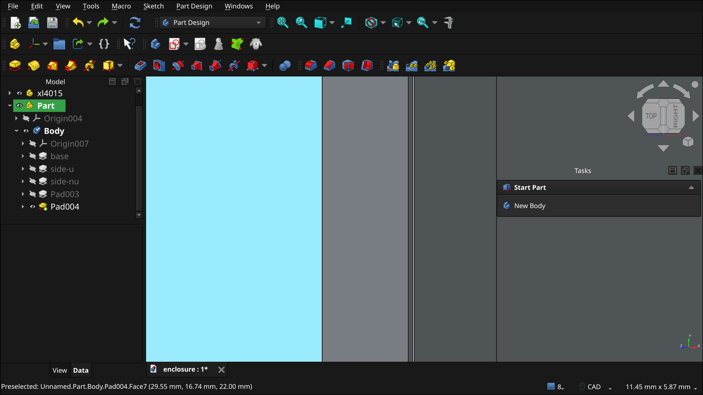

so gonna fix tht tomorrow

**Total time spent: 1.5 hours**

# Rebuild 

i js realised a thing , my freecad process was way too wrong , so i will do something like 3 sketch only rule and the fillets wont betray me again.

lemme del the old sides first

ok so i removed the old sides , 
then i added all 4 sides in one sketch , then fillet , holy it looks so freaking cool why didnt i knew abt fillet before? 
then i made the holes for the usb and in out pins , also 
i added the mounting holes aka bosses for the xl4015 

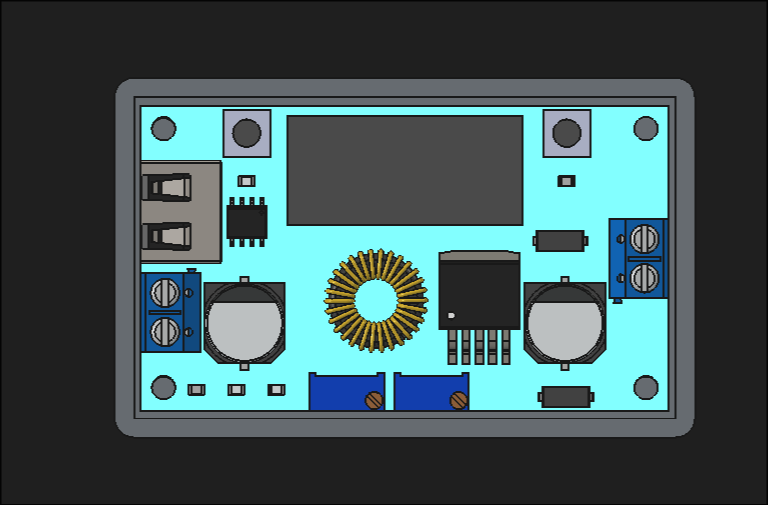

yoo i fillet'ed the holes too it looks so cool 

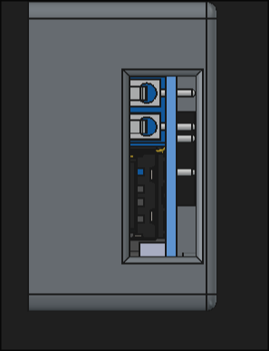

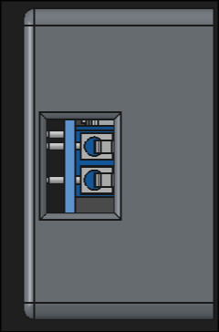

ok done , made the pockets for the display and the potentiometers too 

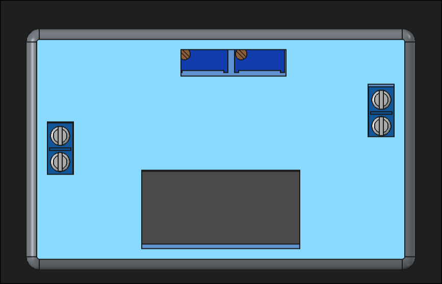

so now i need to export and done 

ok added fillets for the cuts too , but now i realize i needa make them diff parts and add mounting screw too 

uhm so idk why but i accidentally started the suffering arc , and broke the lid part , so imma gonna restart tht :cry:

idkw why there are so many errs 
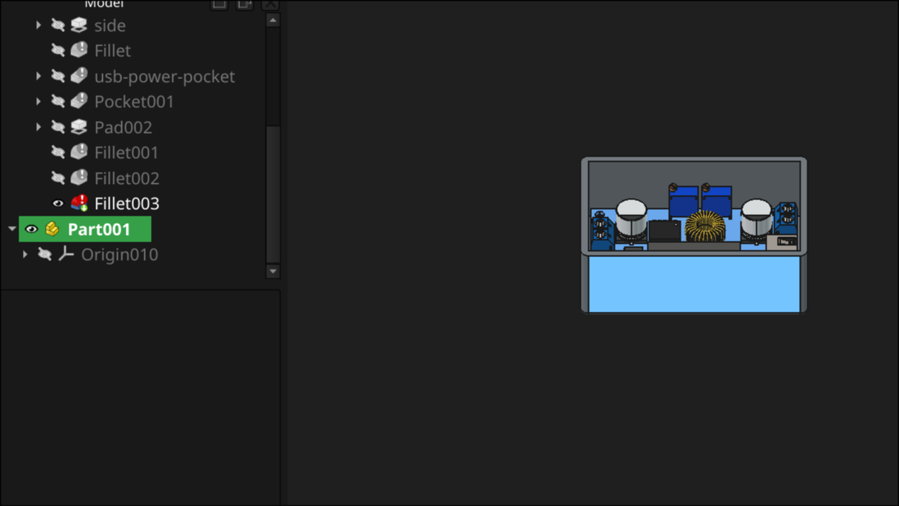

okk so done , i fixed all and made holes for the base tooo , now i can export and then yeah print it 

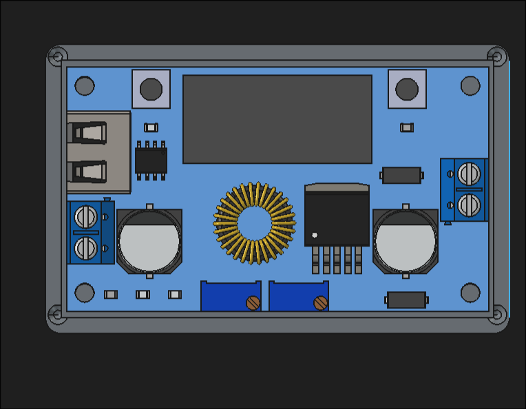

**Total time spent: 2.5 hours**

# extra ventilation  

ok so today i have decided to add some extra ventilation and write the readme , last things for this proj 

okk so for the ventilation , i decided to do the same for my mini client pc t640 , it has straight lines pocketed , easy

like this one look at the top 

but as petg or pla isnt tht strong as steel i wd have to make the vents smaller 

ok so i addded it and it looks pretty sick 

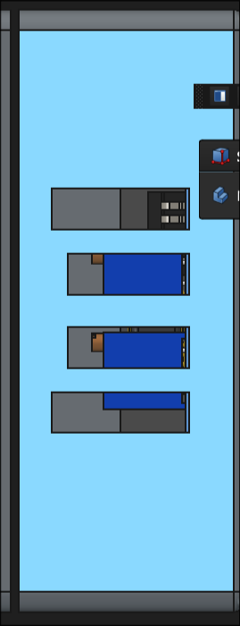

but then the lid looked pretty non polished so i fillet'ed tht tooo 

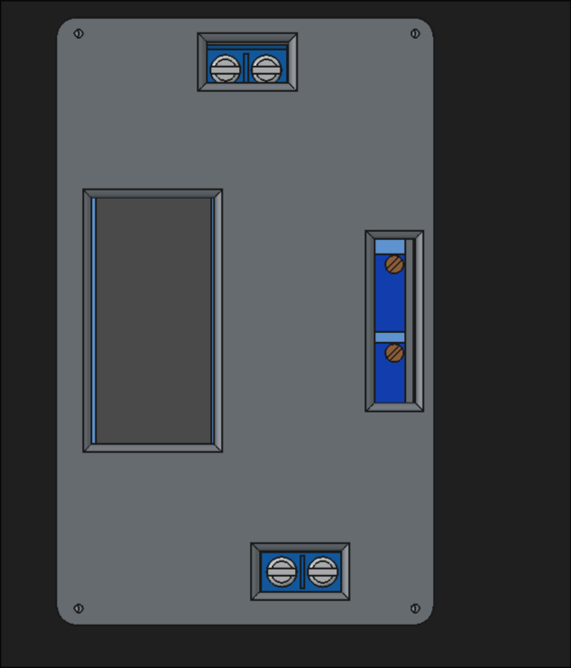

ok i changed the screw and placed it on top of the pcb one because well ihave a cool thing up in my sleeve , its specific type of screw and socket , lemme click a photo

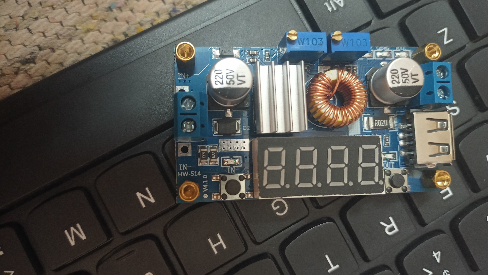

donneee  now i needa reexport , and write a readme 

ok done i added better screws just in case !

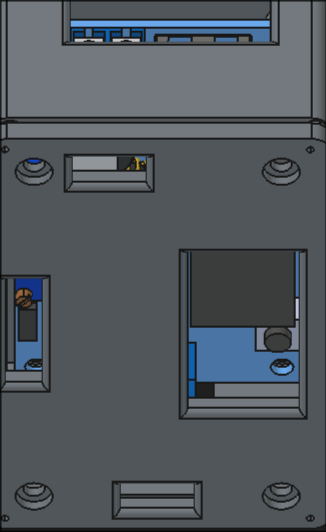

now last thing is readme in next journal 

**Total time spent: 1 hours**

# Readme

ok so now we gonna write the readme , easy job 

ok we got a vol of 
22,478.3 mm^3
for case and
 nah robu did it for me 

okk so i wrote the readme and done now i will push also calculated the prices

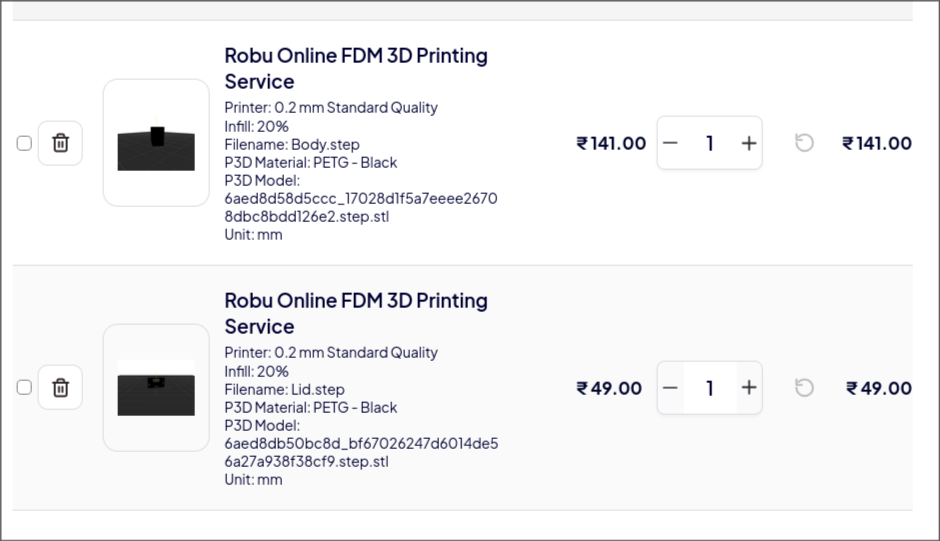

**Total time spent: 1 hours**