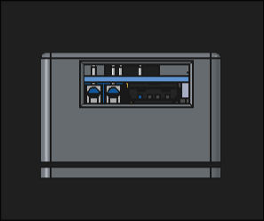
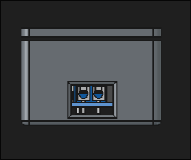
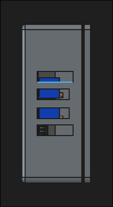
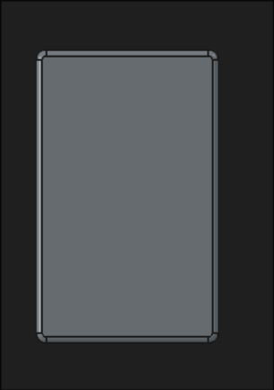
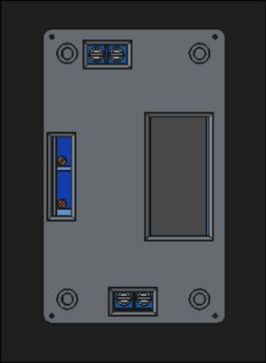
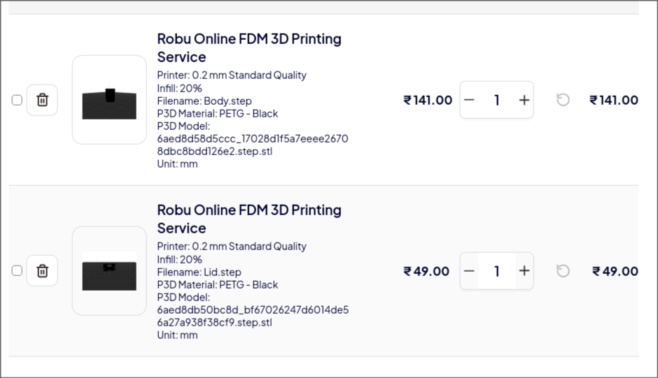

# xl4015-enclosure

a 3d printable enclosure for the `xl4015` module with an 8 bit display and 2 potentiometers :)

---

# Features

- accurate positioning for xl4015 buck step down converter
- provides mechanical support to the fragile pcb
- all the pins, potentiometers, and buttons can be accessed while the case is on
- its open sourced
- polished finishing with fillets
- space left up to 2.5cm for extra heatsink on the xl4015 ic
- moddable `.FCStd` file

---

# Downsides

- ONLY supports the display + 2 potentiometer variant (pretty obvious)
- it is not a tested product
- no parametric tuning supported

---

# How this was made

the enclosure was designed using [FreeCAD](https://www.freecad.org/).

the XL4015 module reference model was taken from GrabCAD and used for positioning and fitting.

the design includes separate body and lid parts, along with a fully assembled STEP file for reference.

Print it and put it on your xl-4015 righttt now

---

# Hardware

### Lid screws => ISO 14583 (partial) with 5mm head diameter

### Board mounting => M2.5 standard, accurate for the XL4015 module (mine one lol)

---

# Preview

### sides:








---

### top and bottom:





---

# Dimensions

### body

X x Y x Z : 7.4 × 2.8 × 4.6 (in cm)

Material Volume : 28.69 cm³

### lid

X x Y x Z : 7.4 × .3 × 4.6 (in cm)

Material Volume : 6.30 cm³

---

# Files

```tree
.
├── assets
│   ├── added_vents.png
│   ├── better-screw.png
│   ├── corner.png
│   ├── errs.png
│   ├── filleted-up-lid.png
│   ├── hl-bs.png
│   ├── pocket.png
│   ├── prev
│   │   ├── bottom.png
│   │   ├── side-no-usb.png
│   │   ├── side-no-vents.png
│   │   ├── side-usb.png
│   │   ├── side-vents.png
│   │   └── top.png
│   ├── screw_or_socket_idk_or_both.jpg
│   ├── side-nousb.png
│   ├── side.png
│   ├── side-usb.png
│   └── vent.jpg
├── cad
│   ├── Body.step
│   ├── enclosure.FCStd
│   ├── enclosure-full.step
│   └── Lid.step
├── extras
│   └── xl4015.step
├── JOURNAL.md
├── LICENSE
└── README.md

5 directories, 26 files
```

- `enclosure.FCStd` is editable and can be opened in FreeCAD.
- `Body.step` is the base part.
- `Lid.step` is the lid.
- `enclosure-full.step` is the fully assembled STEP file with the PCB.
- `xl4015.step` is a reference model taken from GrabCAD.

---

# How to use

### 1. Download the repository

```sh
git clone 
cd xl4015-enclosure
```

### 2. Open the editable file

Open `cad/enclosure.FCStd` using [FreeCAD](https://www.freecad.org/).

### 3. Export or use the STEP files

The `Body.step` and `Lid.step` files can be used separately for 3D printing.

The `enclosure-full.step` file is provided for viewing the assembled design.

---

# Instructions to assemble

print the body and lid.... (i will write this section after doing it myself)

---

# BOM

| Part | Quantity | Unit Price (INR) | Unit Price (USD) | Total (INR) | Total (USD) | Link |
|---|---:|---:|---:|---:|---:|---|
| Base | 1 | 141.00 | 1.50 | 141.00 | 1.50 | [Link](https://robu.in/product/3d-printing-service1/) |
| Lid | 1 | 49.00 | 0.52 | 49.00 | 0.52 | [Link](https://robu.in/product/3d-printing-service1/) |
| Shipping | 1 | 49.00 | 0.52 | 49.00 | 0.52 | — |
| **TOTAL** | | | | **239.00** | **2.54** | |

> i added shipping too because its normal for less than 500rs delivery, also prices might fluctuate over time and the links redirect to printing service not my model



---

# Credits

- a grabcad xl4015 module reference was used from:

[LINKK](https://grabcad.com/library/jacobsparts-xl4015-1)

- [FreeCAD](https://www.freecad.org/)

---
