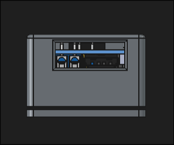
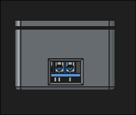
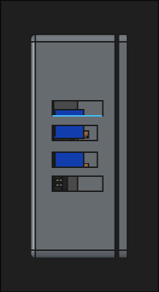
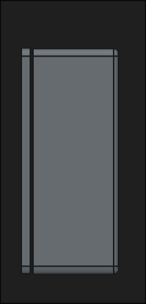
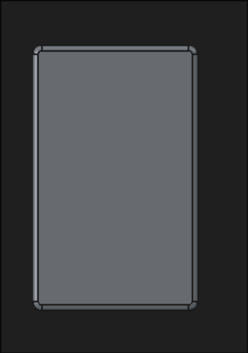
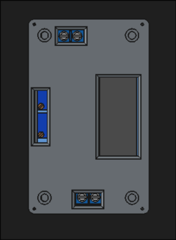
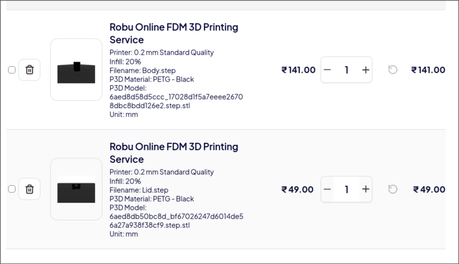

# xl4015-enclosure

A 3d printable enclosure for `xl4015` module with a 8 bit display and 2 potentiameter

---

# Features

- accurate posistioning for xl4015 buck step down converter
- provides mechanical support to the fragile pcb
- all the pins , potentiometer , and buttons can be accessed while case is put on
- Its open sourced 
- polished finishing with fillets 
- space left upto 2.5cm for extra heatsink on the xl4015 ic
- moddable .FCStd 

---

# Downsides

- ONLY supports the display + 2 potentiometer varient
- It is not a tested product
- no parametric tuning supported

---

# Hardware 

### Lid screws => ISO 14583(partial) with 5mm head diameter
### board mounting => M2.5 standard , accurate for the xl4015 module(mine one lol)

---

# Preview

### sides :




---

### top and bottom :



---

## Dimensions 

### body

X x Y x Z : 7.4 × 2.8 × 4.6 (in cm)
Material Volume : 28.69 cm^3

### lid 

X x Y x Z : 7.4 × .3 × 4.6 (in cm)
Material Volume  : 6.30 cm^3

---

# Files 

```tree
.
├── assets
│   ├── added_vents.png
│   ├── better-screw.png
│   ├── corner.png
│   ├── errs.png
│   ├── filleted-up-lid.png
│   ├── hl-bs.png
│   ├── pocket.png
│   ├── prev
│   │   ├── bottom.png
│   │   ├── side-no-usb.png
│   │   ├── side-no-vents.png
│   │   ├── side-usb.png
│   │   ├── side-vents.png
│   │   └── top.png
│   ├── screw_or_socket_idk_or_both.jpg
│   ├── side-nousb.png
│   ├── side.png
│   ├── side-usb.png
│   └── vent.jpg
├── cad
│   ├── Body.step
│   ├── enclosure.FCStd
│   ├── enclosure-full.step
│   └── Lid.step
├── extras
│   └── xl4015.step
├── JOURNAL.md
├── LICENSE
└── README.md

5 directories, 26 files

```

the `enclosure.FCStd` is editable ,  
the lid is the lid , the body is the base part , the enclosure-full is a fully assembled step with the pcb, 
the xl4015.step is a refference taken frm grabcad

---

# Credits

- a grabcad xl4015 module reference was use frm:
[LINKK](https://grabcad.com/library/jacobsparts-xl4015-1)


- Freecad
---

# Instructions to assemble 

print the body and lid....(i will write this section after doing it myself)

---

# Bom

| Part | Quantity | Unit Price (INR) | Unit Price (USD) | Total (INR) | Total (USD) | Link |
|---|---:|---:|---:|---:|---:|---|
| Base | 1 | 141.00 | 1.50 | 141.00 | 1.50 | [Link](https://robu.in/product/3d-printing-service1/) |
| Lid | 1 | 49.00 | 0.52 | 49.00 | 0.52 | [Link](https://robu.in/product/3d-printing-service1/) |
| Shipping | 1 | 49.00 | 0.52 | 49.00 | 0.52 | — |
| **TOTAL** | | | | **239.00** | **2.54** | |

> i added shipping too because its normal for less than 500rs delivery , also Prices might flactuate overtime and the links redirects to printing service not my model 
---

---